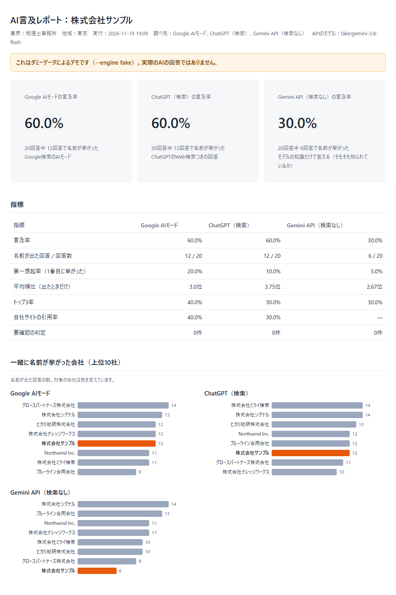

# AI言及チェッカー（ai-mention-checker）

会社名と業界を設定すると、「おすすめの会社は？」系の質問を作り、**Google の AIモード、ChatGPT、Perplexity などの本物のAI検索**と Gemini API に同じ質問をします。そして、**その会社が名前を挙げられたか・何番目か・誰と並べられたか・どのサイトが出典になったか**を、AIごとに並べて HTML レポートにまとめます。AI検索最適化（AIO / LLMO）での「今の状態の診断」と「対策後の効果測定」に使うことを想定しています。

費用は0円です（本物の画面は、人が回答をコピーして取り込みます。API は Gemini の無料枠だけを使います）。

## 調べ先

| 調べ先 | 設定名 | 取り方 | 分かること |
| --- | --- | --- | --- |
| Google AIモード | `google_ai_mode` | 本物の画面から取り込む | Google の AI検索で出てくるか |
| Google AIによる概要 | `google_ai_overview` | 本物の画面から取り込む | ふつうの検索結果の上の AI 回答に出てくるか |
| ChatGPT（検索） | `chatgpt` | 本物の画面から取り込む | ChatGPT が Web を調べて答えたときに出てくるか |
| Perplexity | `perplexity` | 本物の画面から取り込む | Perplexity で出てくるか |
| Gemini アプリ | `gemini_app` | 本物の画面から取り込む | gemini.google.com で出てくるか |
| Gemini API（検索なし） | `plain` | API で自動 | モデルがそもそもその会社を知っているか |
| Gemini API（検索あり） | `grounded` | API で自動 | 検索を使える API キーがある場合だけ（下の「無料枠について」） |

**本物の画面から取り込む**とは、ツールが質問ごとにその画面をブラウザで開き、人が回答の「コピー」ボタンを押して Enter を押すと、ツールがクリップボードから回答と出典URLを読み取ることです。ブラウザの自動操作はしません（各サービスの規約で自動での取得が禁じられているため）。お客さんが実際に見ている画面そのものを測れるのが、API だけで測る方法との違いです。



*上の画像は `--engine fake` で作ったダミーデータのレポートです。*

## しくみ

```
設定 (YAML) → ①質問の生成 → 質問ファイル (人が確認・修正、使い回す)
            → ②各AIに質問 (Gemini API は自動 / 本物の画面は人がコピーして取り込む)
            → ③会社名の抽出 (Flash-Lite, JSON)
            → ④判定・集計 (Python のルールだけ)
            → ⑤HTMLレポート (AIごとに並べる)
```

**LLM の出力は、そのまま数字に使いません。** 数字を決める ④ は Python のルールで行います。

- **対象の会社が出たか**：回答文を正規化（全角・半角、法人格の有無、空白・記号）して、会社名・別名を Python が直接探します。LLM の抽出結果には頼りません。
- **出た会社の並び（順位）**：LLM が抜き出した会社名のうち、**回答文に実際に書かれているものだけ**を残し、回答文の中で出てくる順に並べ直します。書かれていない名前（LLM の作り話）は捨てて、件数をレポートに残します。
- **要確認**：「ミドリムシ」のように別の語の一部として見つかった場合や、文字列としては出ているのに LLM が会社として挙げていない場合（Python と LLM の結果が食い違う場合）は「要確認」として、人が確かめられるようにします。
- **自社サイトの引用**：出典のドメインが公式サイトのドメイン（サブドメインを含む）と一致するかで判定します。

検索あり／なしを分けて出すので、「AIが調べれば出てくるのか」「そもそもモデルに知られているのか」を区別できます。

## 準備（Windows、Python 3.11 以上）

```powershell
python -m venv .venv
.venv\Scripts\Activate.ps1
pip install -r requirements.txt
copy .env.example .env      # .env に GEMINI_API_KEY を書く
copy config\target.example.yaml config\target.yaml   # 対象の会社に書き換える
```

- APIキーは [Google AI Studio](https://aistudio.google.com/) で作ります。**課金を有効にしていないプロジェクト**のキーを使ってください（課金を有効にしたプロジェクトでは、無料枠を超えた分が請求されます）。
- AI Studio の「Rate limit」画面で自分のプロジェクトの上限を確認し、`config/target.yaml` の `limits` に書きます。

## 使い方

```powershell
python run.py --config config/target.yaml --questions-only   # ①だけ。config/questions.yaml を確認・修正する
python run.py --config config/target.yaml                    # ①〜⑤ (質問ファイルがあればそれを使う)
python run.py --config config/target.yaml --engine fake      # APIを使わないデモ
python run.py --report runs/<対象>/<日時>                     # レポートだけ作り直す
```

- 本物の画面の取り込みは、1件あたり30秒〜1分です（質問20個 × 調べ先2つで、30〜40分）。`q` でいつでもやめられ、次に実行すると続きから再開します。
- 取り込みの操作：`Enter`＝取り込む / `n`＝AIの回答が出なかった（AIによる概要が出ないときなど）/ `s`＝今回は飛ばす / `q`＝やめる。クリップボードが質問のままのときや、前の回答と同じときは、取り込まずに知らせます。
- API で使う回数は、調べ先1つにつき質問の数だけです。会社名の抽出には、取り込んだ回答も含めて回答の数だけ使います（質問の生成は最初の1回だけ）。
- 自動実行では `--no-capture` を付けます（API の分だけ回して、取り込みは次に人がいるときに回します）。
- **途中から再開できます。** 回答は1件ずつすぐ保存します。強制終了しても、1日の上限で止まっても、もう一度同じコマンドを実行すると、終わった分を飛ばして続きから回ります（新しく始めたいときは `--new`）。
- 終了コード：`0` 完了 / `2` 1日の上限で停止（翌日、続きから） / `3` 取り込みが残っている（レポートはそこまでの分） / `1` エラー。
- 1日の上限は太平洋時間の0時（日本時間の16〜17時ごろ）に戻るので、回数の記録もその日付で数えています。

### 結果のファイル（`runs/<対象>/<日時>/`）

| ファイル | 中身 |
| --- | --- |
| `questions.yaml` | この実行で使った質問 |
| `answers.jsonl` | 質問、モデル名、日時、回答の全文、出典、検索クエリ（1回答1行） |
| `extracted.jsonl` | LLM が抜き出した会社名（加工前） |
| `mentions.jsonl` | 判定の結果（出たか・順位・要確認の理由・捨てた名前） |
| `summary.json` / `details.csv` | 集計 / 明細（Excel 用） |
| `report.html` | レポート（ブラウザで開いて、そのまま PDF に印刷できます） |

同じ質問セットで実行し直すと、レポートに言及率の推移のグラフが出ます。

### 判定の確かめ方

```powershell
python tools/manual_check.py runs/<対象>/<日時> --make      # 10件を選んで check_sheet.csv を作る
# human 列に 1 (出た) / 0 (出ていない) を書く
python tools/manual_check.py runs/<対象>/<日時> --compare   # ツールの判定と突き合わせる
```

### 毎週の自動実行

```powershell
powershell -ExecutionPolicy Bypass -File tools\register_weekly_task.ps1 -Day Monday -Time 18:00
```

## 指標

| 指標 | 計算のしかた |
| --- | --- |
| 言及率 | 対象が出た回答の数 ÷ 回答の総数 |
| 第一想起率 | 対象が1番目に挙がった回答の数 ÷ 回答の総数 |
| 平均順位 | 対象が出た回答だけで、何番目に挙がったかの平均 |
| トップ3率 | 3番目までに出た回答の数 ÷ 回答の総数 |
| 競合の出現回数 | 対象以外の会社ごとの、名前が出た回答の数 |
| 出典サイトの回数 | 検索ありの回答で、ドメインごとに出典に入った回答の数 |
| 自社サイトの引用率 | 対象のドメインが出典に入った回答の数 ÷ 検索ありの回答の数 |

## 無料枠について（2026年11月時点）

- **新しく作った無料枠のキーでは「検索あり」を使えません**（2026-11-19 に実際に試した結果）。
  - `gemini-2.5-flash` / `gemini-2.5-flash-lite`（無料で検索を使えた 2.5 系）は、「新しいユーザーには提供していない」として 404 が返ります。
  - 3 系（`gemini-3.8-flash`、`gemini-3.5-flash-lite`、`gemini-3.1-flash-lite`）は、検索なしなら無料で動きますが、検索ありは 429 になります。
- そのため「AI検索で出てくるか」は、本物の画面からの取り込み（Google AIモード・ChatGPT など）で測ります。API は「検索なし」（モデルがその会社を知っているか）に使います。検索を使えるキーがあれば `grounded` も足せます（コードはそのまま使えます）。
- 検索ありが使えないキーで `grounded` を指定すると、ツールは無駄に再試行せず、理由を表示して止まります。
- 混雑で 503 が返ることがよくあります。待ち時間を延ばしながら再試行するので、そのまま待ってください。
- モデル名と上限は、すべて設定ファイルで変えられます（コードに数字を固定していません）。
- 無料枠で送った内容は、Google の製品改善に使われます。**公開情報（会社名・業界・地域）だけを入れてください。**

## 制約

- 本物の画面の回答は、ログイン状態・地域・時間で変わります。出典は、コピーした文章に入っていたリンクだけを数えます（画面によっては、コピーに出典が入りません）。
- 調べ先は `src/surfaces.py` に1行足せば増やせます。API で聞く先は `src/engines/` の共通の形（`Engine.generate`）にしてあるので、OpenAI や Claude の API もクラスを1つ足せば対応できます。
- AI の回答は聞くたびに変わります。`ask.repeats` で同じ質問を複数回聞けます（レポートにも何回分の結果かを書きます）。
- 同じ名前の別の会社は、完全には見分けられません。「要確認」の回答は人が読んで確かめてください。

## 開発

```powershell
python -m pytest     # API を使わずに全部確かめる (偽のエンジン・偽のクライアント)
```

構成：`run.py`（①〜⑤のまとめ役）、`src/generate_questions.py`、`src/ask.py`（API）、`src/capture.py`（本物の画面からの取り込み）、`src/surfaces.py`（調べ先の一覧）、`src/clipboard.py`、`src/extract.py`、`src/judge.py`、`src/report.py`、`src/limiter.py`（回数制限・再試行）、`src/normalize.py`（表記ゆれ）、`src/engines/`（gemini / fake）。
